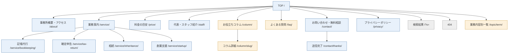

# サイトマップ（あおば税理士事務所）

URL方針：英小文字・短く・2階層まで（例：`/service/bookkeeping/`）

## 1. ツリー図

```
TOP（/）
├─ 事務所概要・アクセス（/about/）
├─ 業務案内（/service/）
│   ├─ 記帳代行（/service/bookkeeping/）
│   ├─ 確定申告（/service/tax-return/）
│   ├─ 相続（/service/inheritance/）
│   ├─ 創業支援（/service/startup/）
│   └─ ※業務を追加する場合は /service/ 配下に子ページを追加
├─ 料金の目安（/price/）
├─ 代表・スタッフ紹介（/staff/）
├─ お役立ちコラム（/column/）            ← CPT アーカイブ
│   └─ コラム詳細（/column/{slug}/）      ← CPT 詳細
├─ よくある質問（/faq/）                  ← CPT アーカイブ（詳細ページなし）
├─ 業務内容別一覧（/topic/{term}/）       ← カスタムタクソノミー アーカイブ（noindex・フィルタ用）
├─ お問い合わせ・無料相談（/contact/）
│   └─ 送信完了（/contact/thanks/）
├─ プライバシーポリシー（/privacy/）
├─ 検索結果（/?s=）
└─ 404（URL なし）
```

## 2. Mermaid



青＝固定ページ／黄＝CPT・タクソノミー／灰＝システムページ

## 3. ページ一覧表

| ページ名 | URL | 階層 | 種類 |
|---|---|---|---|
| TOP | `/` | 0 | 固定（フロントページ） |
| 事務所概要・アクセス | `/about/` | 1 | 固定 |
| 業務案内（一覧） | `/service/` | 1 | 固定 |
| 記帳代行 | `/service/bookkeeping/` | 2 | 固定（子ページ） |
| 確定申告 | `/service/tax-return/` | 2 | 固定（子ページ） |
| 相続 | `/service/inheritance/` | 2 | 固定（子ページ） |
| 創業支援 | `/service/startup/` | 2 | 固定（子ページ） |
| 料金の目安 | `/price/` | 1 | 固定 |
| 代表・スタッフ紹介 | `/staff/` | 1 | 固定 |
| お役立ちコラム（一覧） | `/column/` | 1 | CPT（`column` アーカイブ） |
| コラム詳細 | `/column/{slug}/` | 2 | CPT（`column` 詳細） |
| よくある質問（一覧） | `/faq/` | 1 | CPT（`faq` アーカイブ。詳細ページは無効化） |
| 業務内容別一覧 | `/topic/{term}/` | 2 | CPT（カスタムタクソノミー `topic` のアーカイブ。column / faq 共通。noindex・XMLサイトマップ除外） |
| お問い合わせ・無料相談 | `/contact/` | 1 | 固定（MW WP Form。種別を選択式にする） |
| 送信完了 | `/contact/thanks/` | 2 | 固定（noindex） |
| プライバシーポリシー | `/privacy/` | 1 | 固定 |
| 検索結果 | `/?s=キーワード` | 1 | システム（search.php） |
| 404 | － | － | システム（404.php） |

## 4. 前提・確認事項

- 通常の「投稿」は使用しない（お知らせ等の要件なし）。
- 業務案内は、担当者が子ページを追加できるよう固定ページの親子構造とした。CPT 化する場合は `/service/{slug}/` のまま移行できる。
- 業務内容タクソノミーの term スラッグは、業務案内の子ページスラッグ（bookkeeping 等）と揃える。
- 無料相談とお問い合わせは1フォーム（`/contact/`）に統合。「無料相談／お問い合わせ」の種別を選択式にし、CTAは `/contact/?type=consult` 等でプリセットする（計測は種別ごとに分けられるようにする）。
- 確認画面は設けない想定（MW WP Form で必要なら `/contact/confirm/` 等を追加）。
- 業務内容別一覧（`/topic/{term}/`）はフィルタ機能用として noindex,follow・XMLサイトマップ除外とする。SEOの受け皿は `/service/{slug}/` に集約する。
- 業務案内の「等」の範囲（上記4件以外）はクライアント確認。
- 旧URLがある場合はリダイレクト設計を別途行う（要件定義書 §11）。
- XML サイトマップはプラグインで自動生成（上記ページ一覧とは別）。
- グローバルナビ候補：事務所概要 / 業務案内 / 料金 / スタッフ / コラム / FAQ / 無料相談（CTA）。お問い合わせはヘッダー・フッターの CTA に配置。
